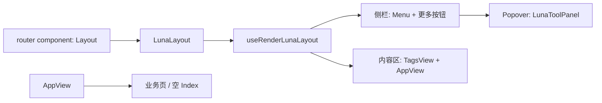

# LunaLayout 全局替换方案

> 来源：`C:\Users\Luna\.cursor\plans\lunalayout_shell_362746b5.plan.md`（Cursor plans 存档副本）

## 已确认决策
- **范围**：`LunaLayout` 替换全局后台壳（静态路由 + `generateRoute` 动态路由），原 `Layout.vue` 保留但不接入。
- **ToolHeader**：侧栏菜单底部「更多/设置」按钮，点击弹出面板承载原 ToolHeader 功能。
- **折叠**：`collapse === true` 时侧栏宽度为 `0`（完全隐藏，不再保留迷你图标栏）；内容区全宽；边缘提供悬浮展开按钮。
- **Footer**：不做专门处理，继续复用现有 [`AppView.vue`](../luna-ui/src/layout/components/AppView.vue)（含其 Footer 逻辑）。

## 架构



接入点：把 [`routerHelper.ts`](../luna-ui/src/utils/routerHelper.ts) 里的

```ts
export const Layout = () => import('@/layout/Layout.vue')
```

改为指向新壳：

```ts
export const Layout = () => import('@/layout/luna/LunaLayout.vue')
```

这样 [`remaining.ts`](../luna-ui/src/router/modules/remaining.ts) 与动态菜单生成无需逐个改符号名。

## 新建文件（只 fork 需要改的壳，复用现有 Menu/TagsView/AppView/UserInfo 等）

目录：`luna-ui/src/layout/luna/`

| 文件 | 作用 |
|------|------|
| `LunaLayout.vue` | 从 `Layout.vue` 复制；调用 `useRenderLunaLayout`；保留移动端遮罩 / Backtop / Setting |
| `useRenderLunaLayout.tsx` | 从 classic 布局精简：无 Logo、无顶部 `ToolHeader`；侧栏含 Menu + 底部更多；折叠宽为 0；内容区全宽；内容区继续用现有 `AppView` |
| `LunaToolPanel.vue` | 移植 `ToolHeader` 右侧能力：账套切换、租户、设置、全屏、搜索、字号、语言、消息、IM、UserInfo（竖排/换行适配弹出框） |
| `LunaMenuReopen.vue` | 折叠完全隐藏后，贴在左侧边缘的展开按钮（`setCollapse(false)`） |

不整目录复制 50+ 共享组件，避免双份维护；原 [`Layout.vue`](../luna-ui/src/layout/Layout.vue) / [`useRenderLayout.tsx`](../luna-ui/src/layout/components/useRenderLayout.tsx) 保持不动作回退参考。

## 行为细节

### 侧栏
- 展开：宽度 `--left-menu-max-width`，上方 `Menu` 占满，底部固定「更多/设置」触发 `ElPopover` / `ElDropdown`。
- 折叠：侧栏 `w-0` + `overflow-hidden`（或 `v-show`），内容区 `w-full left-0`。
- 弹出面板内提供折叠入口（原 Collapse），以及原 ToolHeader 控件；**不**再放顶部横条。
- 面包屑：从顶栏移除后，暂不在弹出框展示（弹出框不适合长路径）；需要时可后续加回内容区。

### `/index`
- 清空 [`views/Home/Index.vue`](../luna-ui/src/views/Home/Index.vue) 为空白占位（保留组件名/`defineOptions`，避免 keep-alive / 路由 name 问题）。
- 路由仍用 `Layout` 符号（实际已是 LunaLayout）+ 空子页。

### 布局模式
- 首期 **只实现 classic 竖侧栏壳**（与当前默认后台一致）。`appStore.layout` 为 top/cutMenu 等时也走同一套 Luna classic 渲染，避免多模式重复做 ToolHeader 迁移；设置面板里的布局切换可后续再接。

## 关键改动清单
1. 新增 `layout/luna/*` 上述文件。
2. 修改 [`utils/routerHelper.ts`](../luna-ui/src/utils/routerHelper.ts)：`Layout` 懒加载指向 `LunaLayout.vue`。
3. 清空 [`views/Home/Index.vue`](../luna-ui/src/views/Home/Index.vue) 内容。
4. 登录后跳转仍为 `/index`（[`permission.ts`](../luna-ui/src/permission.ts) / Login 已如此），无需改路径。

## 验证
- 登录后进入 `/index`：空内容、无 Logo、无顶栏。
- 侧栏展开可见菜单 + 底部「更多」；弹出框内设置/用户/消息等可用。
- 折叠后侧栏彻底消失，悬浮按钮可展开；业务菜单跳转仍在 LunaLayout 内打开。
