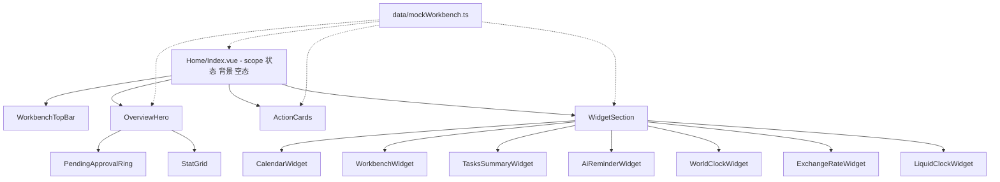

## 产品概述

把 oldweb（React）员工端 /staff 首页工作台中的「总览」界面迁移到 luna-ui（Vue3）的 `/index` 路由页面，作为登录后进入的工作台首页。仅还原「总览」一个界面，生产、财务、个性化三个页签暂不实现内容。界面只做 UI 呈现，所有需要后台数据的位置统一使用模拟数据，不发起任何网络请求。

## 核心功能

1. **顶部工具条**：左侧「工作台 / 当前页签」标识，中间 4 个页签（总览 / 生产 / 财务 / 个性化）胶囊切换，右侧实时走秒时钟与用户头像昵称；点击生产 / 财务 / 个性化时显示空态占位（建设中提示）。
2. **总览 Hero 区**：日期眉标（年月日 + 星期）、按时段问候语 + 用户昵称（昵称以主色渐变高亮）、一句话数据概览副文案、待审批圆环（环形进度 + 中心大数字与单位）、四个统计项（要你批 / 要你跟 / 要你看 / 在产订单），统计项可点击并给出轻提示。
3. **三张动作卡**：要你批 / 要你跟 / 要你看，每张含彩色图标徽章、大数字 + 单位、分类小字、警示提示行、3 行预览条目、底部「查看全部」入口；整卡可点击并给出轻提示。
4. **我的小组件区**：标题 + 卡片栅格，含 7 个轻量小组件——工作日历（日期条 + 当日任务列表 + 智能建议）、我的工作台（工作量三格 + 进度条 + 摘要 + 分组任务列表）、今日任务（数量 + 已完成数）、AI 提醒（铃铛徽章 + 数字 + 摘要）、世界时钟（多城市实时时间）、实时汇率（汇率值 + 更新时间）、液态时钟（滚动数字时钟），数据全部为模拟数据。
5. **视觉风格**：延续源站浅色粉灰渐变底色 + 白色毛玻璃卡片 + 大圆角 + 柔和长投影 + 主色胶囊与圆环强调，数字使用等宽字体；页面在侧边栏折叠/展开与不同屏幕宽度下自适应折列。

## 技术栈

- 框架：Vue 3.5 + TypeScript + Vite（沿用 luna-ui 现有工程，不新增第三方依赖）
- UI 组件库：Element Plus 2.13.7（工程已通过 `unplugin-vue-components` + `ElementPlusResolver` 按需自动引入）+ UnoCSS 原子类 + scoped SCSS
- 图标：项目内置 `Icon` 组件（iconify，用法 `icon="ep:xxx"`）
- 时间与工具：`@vueuse/core` 的 `useNow`、`dayjs`、`lodash-es`
- 动效：CSS 动画 / `Transition` 为主，已安装的 `motion-v` 按需少量使用
- 数据：纯静态 mock 模块 + 组件内 `ref/reactive`，不引入 Pinia（无跨页共享状态）

## 实现方案

- **落点**：整体替换 `luna-ui/src/views/Home/Index.vue`（当前为空壳）；**不改路由、不改 LunaLayout**。`/index` 已挂载 `Layout`（即 `@/layout/luna/LunaLayout.vue`），内容区由 `ElScrollbar` 承载、无 ToolHeader/Logo/Footer，页面自身滚动即可，不做整屏 fixed 背景。
- **职责切分**：`Index.vue` 只做壳——持有 `scope` 状态、渲染背景氛围层、按 scope 渲染总览内容或 `el-empty` 空态；总览内容拆为 4 个区块组件 + 7 个小组件，mock 数据与口径统一沉淀在 `data/mockWorkbench.ts`（含类型），组件只消费不二次计算（保证圆环、统计、动作卡数字同源一致）。
- **Element Plus 替换策略**（不照搬 Tailwind 类名堆砌）：
- 页签滑块：`el-segmented`（已登记样式）承载，用 scoped 样式覆盖为源站胶囊外观；若样式受限则退化为 `el-radio-group` + `el-radio-button`。
- 统计格里数字：轻量自定义布局 + `el-skeleton` 加载态（EP 无对应统计块，保留源视觉）。
- 待审批圆环：保留轻量 SVG 环形（EP 无对等组件，用 `el-progress type="circle"` 会丢失源视觉），进度过渡用 CSS。
- 动作卡与小组件卡：`el-card` + `el-row`/`el-col` 栅格 + 项目 `Icon`。
- 小组件内部：`el-calendar` 不适合源站 10 天日期条，改用 `el-scrollbar` + 自定义日期条；任务列表用 `el-tag`/`el-collapse`；空态统一 `el-empty`；点击提示统一 `useMessage()`（`@/hooks/web/useMessage`，已 auto-import）。
- **性能与可靠性**：
- mock 数据为模块级常量，避免重复构造；时钟统一走 `useNow({ interval: 1000 })`（内部自动启停，避免每个小组件各自 `setInterval` 造成多定时器）。
- 圆环呼吸、光晕旋转、警示脉冲等无限动画只用 `transform`/`opacity`（GPU 友好），并加 `prefers-reduced-motion` 降级；后台壳有折叠过渡，动画不触发额外重排。
- 不引入 `react-grid-layout` 等价物，改用固定响应式栅格（无拖拽、无布局持久化），既贴合本次「仅 UI」边界，也避免额外依赖与布局计算开销。
- 无网络请求，无权限门控，无需 loading 异常分支（保留骨架屏的视觉位置即可）。

## 执行注意事项

- **组件自动注册范围**：`unplugin-vue-components` 的 `globs` 仅包含 `src/components/**`，`src/views/**` 下的新组件**不会自动注册**，需在父组件显式 `import`。
- **auto-import 范围**：仅 `vue`、`vue-router`、`useI18n`、`useMessage` 全局可用；`useDesign`、图标 `Icon` 需显式 import（参照同目录 `Index2.vue` 写法）。
- **主题变量**：源站使用 `--primary-color` / `--primary-color-hover` / `--primary-color-light` / `--home-bg-gradient` / `--border-radius-card`。本次在 `Index.vue` 根节点定义同名局部 CSS 变量并给出源站默认值作为兜底，避免影响后台其它页面的 `--el-color-primary`。
- **保留既有文件**：`Home/Index2.vue`、`Home/types.ts`、`Home/echarts-data.ts` 保持不动（`Index2.vue` 仅作写法参考）。
- **样式隔离**：全部使用 scoped SCSS（可用全局注入的 `$namespace`），不写全局样式；卡片圆角/阴影等公共值抽为局部变量，避免重复定义。

## 架构设计



## 目录结构

```
luna-ui/src/views/Home/
├── Index.vue                                   # [MODIFY] 迁移落点：替换为空壳。职责：持有 scope 状态（overview/production/finance/theme）、定义局部主题 CSS 变量与粉灰渐变背景氛围层、按 scope 渲染总览内容或 el-empty 空态、处理最小内容宽度与滚动，不改路由与 LunaLayout。
├── data/
│   └── mockWorkbench.ts                        # [NEW] 全部模拟数据与类型集中定义。含 HomeScope/ScopeTab/StatItem/ActionCardData/Widget 数据结构、待审批列表、任务列表、消息列表、订单状态计数、世界时钟城市、汇率、日历日程；并提供与源站一致口径的纯函数（如风险任务数、在产订单数、分类小字、最久积压天数）与用户昵称/头像兜底取值（优先读 user store，取不到用 mock）。
└── components/
    ├── WorkbenchTopBar.vue                     # [NEW] 顶栏。职责：左侧「工作台 / 当前页签」标识 + 色块、中间 el-segmented 四页签（含胶囊选中态覆盖样式）、右侧 useNow 走秒时钟 + 昵称首字头像；props: activeScope/availableScopes，emit: change。
    ├── OverviewHero.vue                        # [NEW] 总览 Hero。职责：日期眉标、按时段问候 + 渐变昵称、数据概览副文案、内嵌 PendingApprovalRing 与四个统计项（可点击 emit 提示）；从 mock 取数与口径，骨架屏占位。
    ├── PendingApprovalRing.vue                 # [NEW] 待审批圆环。职责：SVG 环形进度（viewBox 200、半径 85、strokeWidth 13、渐变描边、dashoffset 过渡）+ 中心大数字与单位 + 底部小字 + conic 光晕与呼吸动画（respect prefers-reduced-motion）；props: count/hint。
    ├── ActionCards.vue                         # [NEW] 三张动作卡。职责：区标题（今天 · 共 N 项待处理 / 要处理的三件事）+ el-row/el-col 三列栅格；单卡含图标徽章、大数字 + 单位、分类小字、警示行（脉冲点）、3 行预览条目、可选次要动作、底部「查看全部」；整卡可点击，点击与「查看全部」均走 useMessage 轻提示。
    ├── WidgetSection.vue                       # [NEW] 我的小组件区。职责：区标题（总览 · N 个小组件 / 我的小组件 / 副文案）+ 响应式 el-row/el-col 栅格（xs 24 / sm 12 / lg 6 或 12，固定布局不拖拽），承载 7 个小组件并按源站相对尺寸分配跨度。
    └── widgets/
        ├── WidgetCard.vue                      # [NEW] 小组件统一外壳。职责：毛玻璃卡片容器（标题 + 可选右上插槽 + 内容插槽），统一圆角/描边/投影/内边距变量。
        ├── CalendarWidget.vue                  # [NEW] 工作日历。职责：小标 CALENDAR AND AGENDA + 大标标题、10 天日期条（可横滑，格内星期/日号/任务数徽章/事件彩点/今日小点，选中深色态）、选中日任务列表（已完成删除线 emerald、逾期/受阻红 + 脉冲、进行中 indigo）、空态「该日期暂无协作任务」、底部 AI 智能决策建议。
        ├── WorkbenchWidget.vue                 # [NEW] 我的工作台。职责：标题 + 副行（X 项未完成 · 今天 Y · 逾期 Z）、工作量三格（今天要做/本周要做/逾期，逾期变色）、进度条（已完成/总数 + 剩余步数）、LUNA 摘要条、深色段控（我要做的/我派出去的）、按「逾期与受阻/今天/明天/本周内/以后/没排期/已完成」分组列表（mock）。
        ├── TasksSummaryWidget.vue              # [NEW] 今日任务。职责：标题 + 大数字（今日任务数）+ 单位「项」+ 副行「已完成 n 项」。
        ├── AiReminderWidget.vue                # [NEW] AI 提醒。职责：铃铛徽章（紧急时脉冲）+ 小字标签 + 「AI 提醒 / 系统消息」+ 大数字 + MSG + 标题与详情文案。
        ├── WorldClockWidget.vue                # [NEW] 世界时钟。职责：Globe 图标 + 标题；9 个城市（北京/东京/新加坡/迪拜/伦敦/巴黎/纽约/洛杉矶/悉尼）显示旗帜 + 城市 + HH:MM:SS + 短日期，基于 useNow 每秒刷新。
        ├── ExchangeRateWidget.vue              # [NEW] 实时汇率。职责：标题 + 大数字汇率（保留两位）+ 单位 USD/CNY + 底部「更新 MM/DD HH:MM」（mock 时间）。
        └── LiquidClockWidget.vue               # [NEW] 液态时钟。职责：HH:MM:SS 大号等宽数字，时分秒 digit 滚动动效（Transition 或 CSS），分隔符弱主色，秒位带浅底框。
```

## 关键数据结构

`data/mockWorkbench.ts` 中对外暴露的类型契约（被 Hero / ActionCards / WidgetSection 共同消费，需先定稿）：

```ts
export type HomeScope = 'overview' | 'production' | 'finance' | 'theme'

export interface ScopeTab { key: HomeScope; label: string }

export interface StatItem {
  key: 'approve' | 'follow' | 'read' | 'orders'
  label: string
  value: number
  unit: string
  tone?: 'default' | 'ok' | 'bad'
}

export interface ActionCardData {
  key: 'approve' | 'follow' | 'read'
  label: string
  value: number
  unit: string
  brk: string
  warning?: string
  secondary?: string
  moreText: string
  previewRows: { title: string; sub: string; value: string }[]
}
```

## 设计风格

延续 oldweb 员工端工作台的浅色毛玻璃风格，并适配 Element Plus 组件外观：页面底色为浅粉灰纵向渐变，卡片为半透明白 + 背景模糊 + 细白描边 + 大圆角（24 至 30px）+ 柔和长投影；强调采用深石板色胶囊与主色渐变（圆环、昵称、入口链接），危险类提示用红色、警示用琥珀色、成功用翠绿色。数字统一等宽字体、大字号、紧凑字距，营造仪表盘质感。整体在后台内容区内自适应，不做整屏 fixed，侧边栏折叠/展开与窄屏下均可正常折列。

## 页面规划（单页：/index 工作台总览）

按自上而下分块，全部内容置于最大宽度 1600px 的居中容器，块间距 24 至 32px：

1. **顶栏 WorkbenchTopBar（吸顶）**：毛玻璃圆角条。左侧主色渐变小色块 + 「工作台」+ 「/ 当前页签」；中间胶囊页签组，选中项主色胶囊白字并有滑动过渡；右侧等宽走秒时钟 + 主色渐变方形头像（昵称首字）。窄屏下允许换行。
2. **Hero OverviewHero**：日期眉标一行；超大渐变昵称问候（字号随视口缩放）；副文案一句话概览并加粗关键数字；其下为待审批圆环（带光晕与呼吸）与四个统计格横向排列，统计格之间以淡竖线分隔，可点时 hover 轻微上浮。
3. **ActionCards 三张动作卡**：区标题两行（小字统计 + 大标）与副文案；三列卡片，每张含左上角彩色光斑、彩色图标徽章、标签、超大数字 + 单位、分类小字、带脉冲点的警示行、三条预览行（标题 + 副行 + 右侧值 + 右箭头）、底部主色「查看全部」入口；hover 上浮并出现掠光。
4. **我的小组件 WidgetSection**：区标题（小字「总览 · N 个小组件」+ 大标 + 副文案）；其下响应式栅格铺开 7 个毛玻璃小组件，日历与我的工作台占较大跨度，其余时钟/汇率/提醒/今日任务为小跨度。
5. **非总览页签空态**：生产 / 财务 / 个性化三个页签切换后显示居中 `el-empty` 空态提示（对应文案分别为生产、财务、个性化建设中），保留顶栏不变。

## 响应式与交互

- 断点：小于 768px 单列堆叠、统计格两列换行、顶栏换行；768 至 1199px 动作卡两列或一列、小组件两列；1200px 以上动作卡三列、小组件三列（日历/工作台占 12 栅格中的 6）。
- 交互：页签切换带胶囊滑动与内容淡入；卡片 hover 上浮 + 掠光；统计项与「查看全部」点击给出轻提示；时钟每秒更新；圆环进度入场一次性过渡动画。
- 无障碍与降级：交互元素可键盘聚焦，`prefers-reduced-motion` 时关闭呼吸/旋转/脉冲等无限动画。

## Agent Extensions

### SubAgent

- **code-explorer**
- Purpose: 在实现小组件前，核对源站 `CalendarTodoCard`、`WorkbenchPanel`、`AiReminderWidget`、`widgetRegistry` 内联的世界时钟/汇率/今日任务等组件的展示字段与文案口径，避免臆造字段或漏掉区块。
- Expected outcome: 输出各小组件所需的字段名、分组/状态标签与文案清单，直接指导 `data/mockWorkbench.ts` 与各 widget 组件实现。
- **code-reviewer**
- Purpose: 迁移完成后审查新增组件的代码质量，检查 Element Plus 组件用法与按需引入规范、scoped 样式与命名一致性、定时器/动效清理、以及是否误引入网络请求或改动无关文件。
- Expected outcome: 给出问题清单与修改建议，确认无阻塞性问题后收尾。

### Skill

- **playwright-cli**
- Purpose: 启动 luna-ui 开发服务并打开 `/index`，对总览页与三个空态页签截图，核对区块顺序、配色、栅格折列与源站视觉一致。
- Expected outcome: 输出各断点截图，确认总览完整可见、空态正确显示、无布局溢出。