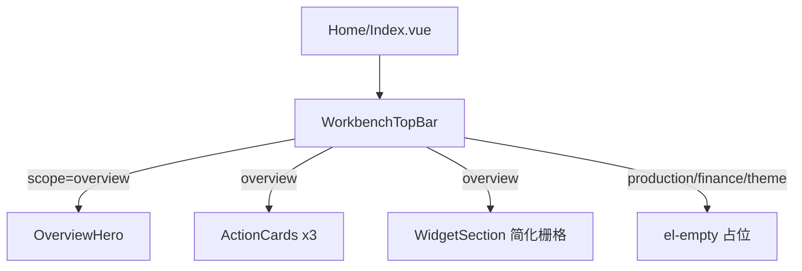

# Staff 工作台总览迁移到 `/index`

## 目标与边界

- **迁入位置**：[`luna-ui/src/views/Home/Index.vue`](luna-ui/src/views/Home/Index.vue)（路由 `/index` 已接 LunaLayout，无需改路由）
- **源站入口**：[`oldweb/app/staff/components/dashboard/IntelligentFeedTab.tsx`](oldweb/app/staff/components/dashboard/IntelligentFeedTab.tsx) + `home/*`
- **只做总览**：顶栏四个 scope（总览 / 生产 / 财务 / 个性化）都可切换；**仅 `overview` 有内容**，其余显示空态占位（如 `el-empty`）
- **不接真 API**：审批 / 任务 / 消息 / 订单等全部走本地 mock
- **不照搬实现**：用 Element Plus（`el-segmented`/`el-tabs`、`el-card`、`el-row`/`el-col`、`el-avatar`、`el-progress`/`el-skeleton`、`el-calendar`、`el-table`/`el-scrollbar` 等）重构；保留源站信息架构与视觉层级，不移植 `react-grid-layout`、不迁审批弹窗业务逻辑

## 页面结构（总览）

自上而下对齐源站总览：

1. **顶栏**：左「工作台 / 总览」、中 scope 切换、右时钟 + 用户头像昵称  
2. **Hero**：日期 eyebrow、时段问候 + 昵称、副文案、待审批圆环、四个统计（要你批 / 要你跟 / 要你看 / 在产订单）  
3. **三张动作卡**：要你批 / 要你跟 / 要你看（数字、分类小字、警示、预览行、「查看全部」）  
4. **我的小组件**：固定 mock 卡片栅格（不做拖拽、不做布局持久化）

## 目录规划

在 `luna-ui/src/views/Home/` 下拆分：

| 路径 | 职责 |
|------|------|
| `Index.vue` | scope 状态、组装布局、背景氛围 |
| `components/WorkbenchTopBar.vue` | 顶栏 + scope 切换（优先 `el-segmented`） |
| `components/OverviewHero.vue` | 问候 / 圆环 / 四统计 |
| `components/ActionCards.vue` | 三张动作卡 |
| `components/WidgetSection.vue` | 「我的小组件」标题 + `el-row` 栅格 |
| `components/widgets/*.vue` | 少量代表性小组件 UI |
| `data/mockWorkbench.ts` | 全部 mock 类型与假数据 |
| `composables/useWorkbenchScope.ts` | scope 与问候/时钟小逻辑（可选） |

用户展示：从现有 user store（如 `useUserStore`）读昵称/头像；读不到则 mock 默认名。

## Element Plus 映射（相对源站）

| 源站 | Vue3 做法 |
|------|-----------|
| 自绘 scope 滑块 | `el-segmented`（或 `el-radio-group` button） |
| 自绘统计块 | `el-statistic` 或轻量自定义 + `el-skeleton` |
| 待审批圆环 | 保留轻量 SVG 圆环（EP 无对等），或 `el-progress` type=circle 作降级方案；优先 SVG 以贴近源视觉 |
| 三张动作卡 | `el-card` + `@element-plus/icons-vue` |
| 可拖拽 WidgetGrid | **不做**；`el-row`/`el-col` + `el-card` 固定布局 |
| 日历 / 任务列表等 | `el-calendar`、`el-table` 或列表 + `el-tag` |
| 汇率 / 时钟 | 简单展示卡 + mock 数字；时钟用本地 `setInterval` |

动效：项目已有 `motion-v`，Hero/卡片入场可用少量 motion；不强制复刻全部 framer 细节。

## Mock 数据（对齐源口径，写死即可）

在 `data/mockWorkbench.ts` 提供例如：

- `approvals[]`、`tasks[]`、`messages[]`、`orderStats`（含在产状态计数）
- 聚合后的 `counts` / `hints` / 动作卡 `previewRows`
- 小组件用：今日任务列表、汇率、世界时钟城市、日历标记等

点击「查看全部」/统计项：第一期用 `ElMessage.info` 提示即可（不弹源站那套审批 Modal）。

## 小组件范围（已定默认）

迁入 **简化版** 总览默认布局中的轻量件（UI + mock），例如：

- 日历、我的工作 / 今日任务、世界时钟、实时汇率  
- 可选再加一张「AI 提醒」占位卡  

**不做**：合同进度 / 染色指示等重业务表、拖拽编辑、布局云同步、生产/财务专属 widget。

## 明确不做

- 生产 / 财务 Hero 与对应 WidgetGrid  
- 个性化主题面板  
- 审批批驳、任务操作、消息已读等交互对接  
- 改 LunaLayout / 权限路由  
- 照抄 Tailwind 类名堆砌；样式用 scoped SCSS + CSS 变量，贴近源站浅色毛玻璃气质，但服从后台壳内可用高度

## 验证

- 登录后进 `/index`：总览完整可见，切换另三个页签为空态  
- 桌面 / 窄屏：顶栏换行、Hero 居中、动作卡与小组件栅格可折列  
- 无网络请求依赖（浏览器 Network 无审批/任务相关调用）
